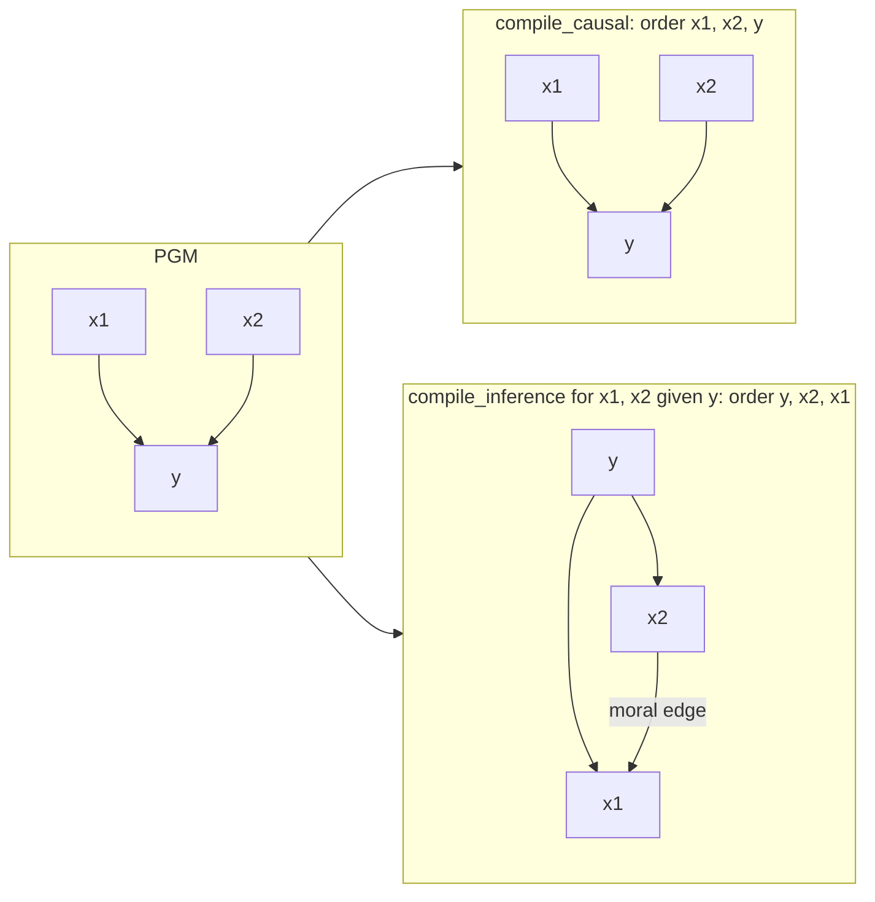

# StructFlow

Compile a probabilistic graphical model (PGM) and a query into a structured,
block-triangular continuous normalizing flow, in
[JAX](https://github.com/google/jax) / [Equinox](https://github.com/patrick-kidger/equinox).
This is the library behind the paper
**"Structured Flows for Causal Modelling and Statistical Inference"**
(Telfar & Sandfeld, TMLR 2026, [OpenReview](https://openreview.net/forum?id=5cFwygAUFt)).
The experiments, evaluation and LaTeX source of the paper live in
[structflows-tmlr](https://github.com/AI4PSE/structflows-tmlr).

- **Causal alignment** keeps the DAG factorization: the trained flow is a
  structural causal model, so it answers interventional and counterfactual
  queries.
- **Inference alignment** re-orders and moralizes the graph for amortized
  posterior inference.
- Conditions enter each block **statically** (integrated to completion, then
  fixed) or **dynamically** (co-evolving with the targets in one parallel ODE
  solve). Dynamic conditioning is consistent only with a per-block
  (Knothe–Rosenblatt) noise–data coupling, `use_coupling='c2ot'`; see the
  paper's appendix.

## Packages

| package | purpose |
| :--- | :--- |
| [`structflow.pgms`](structflow/pgms/README.md) | synthetic PGM benchmarks with known structural equations; the compiler from a DAG to causal / inference block structures |
| [`structflow.conditional_flows`](structflow/conditional_flows/README.md) | conditional flows `p(targets \| conditions)`: `static`, `dynamic` (parallel), `guided` (reconstruction guidance), and the CAREFL / DCM baselines; factories `create_*_flow`, `create_distribution` |
| [`structflow.bayes`](structflow/bayes/README.md) | distribution objects, NUTS reference posteriors, metrics (SWD, Sinkhorn, KL) |

Dependency maintained separately: [`sinterp-jax`](https://github.com/act65/sinterp),
which provides two packages, `sinterp` (interpolants and couplings, including the
C²OT / per-block coupling) and `flow` (ODE/SDE integration).

## Install

Install JAX for your hardware first (`pip install "jax[cpu]"` or
`"jax[cuda12]"`), then

```bash
pip install "structflow-jax @ git+https://github.com/AI4PSE/structflows@v0.1.1"   # import structflow
```

This pulls `sinterp-jax` from its GitHub tag. From a clone:
`pip install -e ".[dev]"`.

## Quickstart: a collider

Take two independent causes and a common effect, `x1 -> y <- x2`, with
`x1, x2 ~ N(0, 1)` and `y = x1 + x2 + 0.5 eps`. The compiler turns the graph and a query
into a block-triangular flow structure. For causal queries it keeps the DAG. For the
posterior `p(x1, x2 | y)` it puts the observation first and *moralizes*: observing `y`
couples its causes, so the inference structure gains the edge `x2 -> x1`
("explaining away").



Train one static structured flow per compiled structure, on the same data:

```python
import jax, jax.numpy as jnp, equinox as eqx, optax
from jax import random
from structflow.pgms import BlockTriangularStructure, StructuralPGM, PGMCompiler
from structflow.pgms.mechanisms import LinearMechanism
from structflow.conditional_flows import create_static_flow, create_distribution

# ground truth: x1, x2 ~ N(0, 1);  y = x1 + x2 + 0.5 * eps
structure = BlockTriangularStructure(block_order=["x1", "x2", "y"],
                                     dependencies={"x1": [], "x2": [], "y": ["x1", "x2"]},
                                     dims={"x1": 1, "x2": 1, "y": 1})
root = lambda: LinearMechanism(parent_names=[], input_dim=0, output_dim=1,
                               A=jnp.zeros((1, 0)), B=jnp.eye(1), bias=jnp.zeros(1))
effect = LinearMechanism(parent_names=["x1", "x2"], input_dim=2, output_dim=1,
                         A=jnp.ones((1, 2)), B=0.5 * jnp.eye(1), bias=jnp.zeros(1))
pgm = StructuralPGM(structure, {"x1": root(), "x2": root(), "y": effect})
data = pgm.b_sample(random.PRNGKey(0), 4096)              # {'x1': (4096, 1), ...}

compiler = PGMCompiler(structure.dependencies, structure.dims)
causal = compiler.compile_causal()
inference = compiler.compile_inference(targets={"x1", "x2"}, conditions={"y"})

def train(s, key, steps=2000):
    opt = optax.adam(3e-3)
    model, step = create_static_flow(structure=s, depth=3, width=64, model_key=key, optimizer=opt)
    opt_state = opt.init(eqx.filter(model, eqx.is_array))
    for k in random.split(key, steps):
        model, opt_state, _, loss = step(model, opt_state, None, data, k)
    return create_distribution(mode="static", model=model, structure_dict={
        "dependencies": s.dependencies, "block_order": s.block_order, "dims": s.dims})

causal_flow, inference_flow = train(causal, random.PRNGKey(1)), train(inference, random.PRNGKey(2))

# posterior p(x1, x2 | y = 2), sampled directly (no MCMC)
post = inference_flow.b_sample(random.PRNGKey(3), 2000, conditions={"y": jnp.array([2.0])})
print(jnp.corrcoef(post["x1"][:, 0], post["x2"][:, 0])[0, 1])   # exact: -0.8

# intervention E[y | do(x1 = 2)]
y_do = jax.vmap(lambda k: causal_flow.sample(k, targets={"x2", "y"},
                                             interventions={"x1": jnp.array([2.0])})["y"])(
    random.split(random.PRNGKey(4), 2000))
print(y_do.mean())                                              # exact: 2.0

# counterfactual: had x1 been 2, what would this individual's y have been?
factual = {b: v[0] for b, v in data.items()}
cf, _ = causal_flow.counterfactual(factual, interventions={"x1": jnp.array([2.0])}, targets={"y"})
print(cf["y"], factual["y"] + 2.0 - factual["x1"])              # flow vs exact
```

[`examples/structflow_quickstart.py`](examples/structflow_quickstart.py) runs the same
pipeline with the checks spelled out (about a minute on a laptop CPU):

```text
causal    order ['x1', 'x2', 'y']  parents {'x1': [], 'x2': [], 'y': ['x1', 'x2']}
inference order ['y', 'x2', 'x1']  parents {'y': [], 'x2': ['y'], 'x1': ['y', 'x2']}

1. posterior given y = 2.0
   corr(x1, x2): a priori +0.03; given y: flow -0.85, exact -0.80
   E[x1 | y], E[x2 | y]: flow 0.91, 0.79; exact 0.89

2. E[y | do(x1 = 2)]: flow 2.18, exact 2.00

3. observed x1 = -1.46, x2 = -1.39, y = -3.48
   had x1 been 2, y would have been: flow -0.12, exact -0.01
```

The ground-truth PGM answers the same queries exactly where they are tractable:
`pgm.log_prob(x, targets, conditions)` for ancestral queries, `pgm.counterfactual(...)`,
and `pgm.sample(...)` (MCMC for non-ancestral conditionals). `structflow.pgms` also
provides random benchmark PGMs (`make_random_pgm`, `make_chain_pgm`, `make_collider_pgm`).

## Tests

```bash
JAX_PLATFORMS=cpu pytest -m "not slow"     # fast subset
pytest --run-expensive                      # everything (a GPU helps)
```

`structflow/conditional_flows/tests/test_claims.py` holds regression tests for
the paper's claims (triangular masks stay triangular after training, coupling
parity, dynamic-conditioning consistency under the per-block coupling).

## Citation

```bibtex
@article{telfar2026structured,
  title   = {Structured Flows for Causal Modelling and Statistical Inference},
  author  = {Telfar, Alexander and Sandfeld, Stefan},
  journal = {Transactions on Machine Learning Research},
  year    = {2026},
  url     = {https://openreview.net/forum?id=5cFwygAUFt}
}
```

## License

MIT, see [LICENSE](LICENSE).
