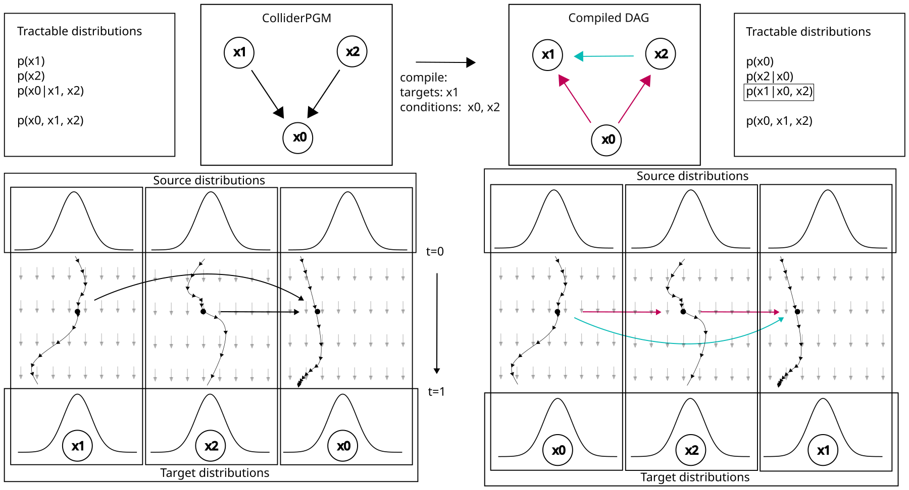

# StructFlow

Compile a probabilistic graphical model (PGM) and a query into a structured,
block-triangular continuous normalizing flow, in
[JAX](https://github.com/google/jax) / [Equinox](https://github.com/patrick-kidger/equinox).
This is the library behind the paper
**"Structured Flows for Causal Modelling and Statistical Inference"**
(Telfar & Sandfeld, TMLR 2026, [OpenReview](https://openreview.net/forum?id=5cFwygAUFt)).
The experiments, evaluation and LaTeX source of the paper live in
[structflows-tmlr](https://github.com/AI4PSE/structflows-tmlr).

- **Causal alignment** keeps the DAG factorization: the trained flow is a
  structural causal model, so it answers interventional and counterfactual
  queries.
- **Inference alignment** re-orders and moralizes the graph for amortized
  posterior inference.
- Conditions enter each block **statically** (integrated to completion, then
  fixed) or **dynamically** (co-evolving with the targets in one parallel ODE
  solve). Dynamic conditioning is consistent only with a per-block
  (Knothe–Rosenblatt) noise–data coupling, `use_coupling='c2ot'`; see the
  paper's appendix.

## How it works



*Figure 1 of the paper.* A collider PGM (`x1 -> x0 <- x2`, top centre-left) and the query
`p(x1 | x0, x2)` go into the compiler. The compiled DAG (top centre-right) puts the
conditions first and *moralizes* the graph: because `x0` is observed, its two causes are no
longer independent, so the compiled structure gains the edge `x2 -> x1` (teal). The boxes on
either side list the distributions each structure can answer exactly. Below each DAG is the
corresponding flow: one block per variable, each transporting noise (top) to data (bottom),
with each block's velocity conditioned on its parents in the compiled DAG.

## Packages

| package | purpose |
| :--- | :--- |
| [`structflow.pgms`](structflow/pgms/README.md) | synthetic PGM benchmarks with known structural equations; the compiler from a DAG to causal / inference block structures |
| [`structflow.conditional_flows`](structflow/conditional_flows/README.md) | conditional flows `p(targets \| conditions)`: `static`, `dynamic` (parallel), `guided` (reconstruction guidance), and the CAREFL / DCM baselines; factories `create_*_flow`, `create_distribution` |
| [`structflow.bayes`](structflow/bayes/README.md) | distribution objects, NUTS reference posteriors, metrics (SWD, Sinkhorn, KL) |

Dependency maintained separately: [`sinterp-jax`](https://github.com/act65/sinterp),
which provides two packages, `sinterp` (interpolants and couplings, including the
C²OT / per-block coupling) and `flow` (ODE/SDE integration).

## Install

Install JAX for your hardware first (`pip install "jax[cpu]"` or
`"jax[cuda12]"`), then

```bash
pip install "structflow-jax @ git+https://github.com/AI4PSE/structflows@v0.1.3"   # import structflow
```

This pulls `sinterp-jax` from its GitHub tag. From a clone:
`pip install -e ".[dev]"`.

## Quickstart: a collider, end to end

The example below is the collider of Figure 1 with explicit equations, so every answer has a
closed form to check against:

```math
x_1,\ x_2 \sim \mathcal{N}(0, 1), \qquad x_0 = x_1 + x_2 + 0.5\,\varepsilon, \qquad \varepsilon \sim \mathcal{N}(0, 1).
```

It trains two flows on the same data, one per compiled structure, and asks three kinds of
question: a posterior, an intervention and a counterfactual.

**1. Define the ground-truth model and sample training data.** A `StructuralPGM` is a DAG
(`BlockTriangularStructure`) plus one mechanism per node. Here each mechanism is linear:
`x = A @ parents + B @ noise + bias`.

```python
import jax, jax.numpy as jnp, equinox as eqx, optax
from jax import random
from structflow.pgms import BlockTriangularStructure, StructuralPGM, PGMCompiler
from structflow.pgms.mechanisms import LinearMechanism
from structflow.conditional_flows import create_static_flow, create_distribution

structure = BlockTriangularStructure(
    block_order=["x1", "x2", "x0"],
    dependencies={"x1": [], "x2": [], "x0": ["x1", "x2"]},   # node -> its parents
    dims={"x1": 1, "x2": 1, "x0": 1},
)
cause = lambda: LinearMechanism(parent_names=[], input_dim=0, output_dim=1,      # x = noise
                                A=jnp.zeros((1, 0)), B=jnp.eye(1), bias=jnp.zeros(1))
effect = LinearMechanism(parent_names=["x1", "x2"], input_dim=2, output_dim=1,   # x0 = x1 + x2 + 0.5 noise
                         A=jnp.ones((1, 2)), B=0.5 * jnp.eye(1), bias=jnp.zeros(1))
pgm = StructuralPGM(structure, {"x1": cause(), "x2": cause(), "x0": effect})

data = pgm.b_sample(random.PRNGKey(0), 4096)      # dict of arrays: {'x1': (4096, 1), ...}
```

**2. Compile the graph for each kind of query.** The causal structure keeps the DAG, so
its flow is a structural causal model. The inference structure for `p(x1, x2 | x0)` puts `x0`
first and adds the moral edge `x2 -> x1`.

```python
compiler = PGMCompiler(structure.dependencies, structure.dims)
causal = compiler.compile_causal()
inference = compiler.compile_inference(targets={"x1", "x2"}, conditions={"x0"})

print(causal.block_order, causal.dependencies)
# ['x1', 'x2', 'x0'] {'x1': [], 'x2': [], 'x0': ['x1', 'x2']}
print(inference.block_order, inference.dependencies)
# ['x0', 'x2', 'x1'] {'x0': [], 'x2': ['x0'], 'x1': ['x0', 'x2']}
```

**3. Train one structured flow per compiled structure.** `create_static_flow` builds a
flow-matching model whose blocks follow the structure; `create_distribution` wraps the
trained model with `sample`, `log_prob` and `counterfactual`.

```python
def train(compiled, key, steps=2000):
    optimizer = optax.adam(3e-3)
    model, step = create_static_flow(structure=compiled, depth=3, width=64,
                                     model_key=key, optimizer=optimizer)
    opt_state = optimizer.init(eqx.filter(model, eqx.is_array))
    for k in random.split(key, steps):                       # full-batch training
        model, opt_state, _, loss = step(model, opt_state, None, data, k)
    return create_distribution(mode="static", model=model, structure_dict={
        "dependencies": compiled.dependencies, "block_order": compiled.block_order,
        "dims": compiled.dims})

causal_flow = train(causal, random.PRNGKey(1))         # answers do() and counterfactuals
inference_flow = train(inference, random.PRNGKey(2))   # answers p(x1, x2 | x0)
```

**4. Ask questions.** Each answer is printed next to its closed form.

```python
# Posterior: observing a large x0 makes the independent causes negatively correlated
# ("explaining away"). Sampled directly from the inference flow; no MCMC.
post = inference_flow.b_sample(random.PRNGKey(3), 2000, conditions={"x0": jnp.array([2.0])})
print("corr(x1, x2 | x0=2):", jnp.corrcoef(post["x1"][:, 0], post["x2"][:, 0])[0, 1], "exact -0.8")

# Intervention: set x1 = 2 by surgery on the causal flow and sample x0.
do_x1 = {"x1": jnp.array([2.0])}
x0_do = jax.vmap(lambda k: causal_flow.sample(k, targets={"x2", "x0"}, interventions=do_x1)["x0"])(
    random.split(random.PRNGKey(4), 2000))
print("E[x0 | do(x1=2)]:", x0_do.mean(), "exact 2.0")

# Counterfactual: for each observed individual, what would x0 have been had x1 been 2?
# Abduction recovers the individual's noise, which is then pushed through the modified model.
# Exact answer: x0 + (2 - x1). Compared over 100 individuals (noise s.d. on x0 is 0.5).
factuals = {name: values[:100] for name, values in data.items()}
cf = jax.vmap(lambda d: causal_flow.counterfactual(
    d, interventions=do_x1, targets={"x0"}, compute_log_prob=False)[0]["x0"])(factuals)
exact = factuals["x0"] + 2.0 - factuals["x1"]
print("mean |counterfactual error|:", jnp.mean(jnp.abs(cf - exact)))
```

[`examples/structflow_quickstart.py`](examples/structflow_quickstart.py) runs the same
steps as a script (about a minute on a laptop CPU):

```text
1. posterior given x0 = 2.0
   corr(x1, x2): a priori +0.03; given x0: flow -0.85, exact -0.80
   E[x1 | x0], E[x2 | x0]: flow 0.91, 0.79; exact 0.89

2. E[x0 | do(x1 = 2)]: flow 2.18, exact 2.00

3. counterfactual x0 had x1 been 2, for 100 observed individuals
   first: observed x1 = -1.46, x0 = -3.48; flow -0.12, exact -0.01
   mean |flow - exact| = 0.16   (noise s.d. on x0: 0.5)
```

The ground-truth PGM answers the same queries where they are tractable:
`pgm.log_prob(x, targets, conditions)` for ancestral queries, `pgm.counterfactual(...)`,
and `pgm.sample(...)` (MCMC for non-ancestral conditionals). `structflow.pgms` also
provides random benchmark PGMs (`make_random_pgm`, `make_chain_pgm`, `make_collider_pgm`).

## Tests

```bash
JAX_PLATFORMS=cpu pytest -m "not slow"     # fast subset
pytest --run-expensive                      # everything (a GPU helps)
```

`structflow/conditional_flows/tests/test_claims.py` holds regression tests for
the paper's claims (triangular masks stay triangular after training, coupling
parity, dynamic-conditioning consistency under the per-block coupling).

## Citation

```bibtex
@article{telfar2026structured,
  title   = {Structured Flows for Causal Modelling and Statistical Inference},
  author  = {Telfar, Alexander and Sandfeld, Stefan},
  journal = {Transactions on Machine Learning Research},
  year    = {2026},
  url     = {https://openreview.net/forum?id=5cFwygAUFt}
}
```

## License

MIT, see [LICENSE](LICENSE).
